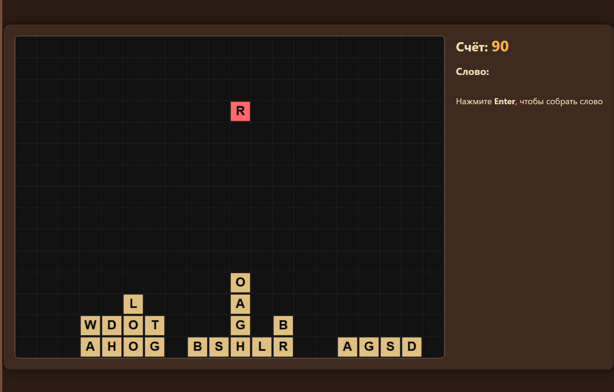
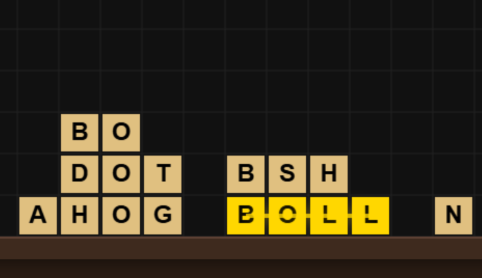
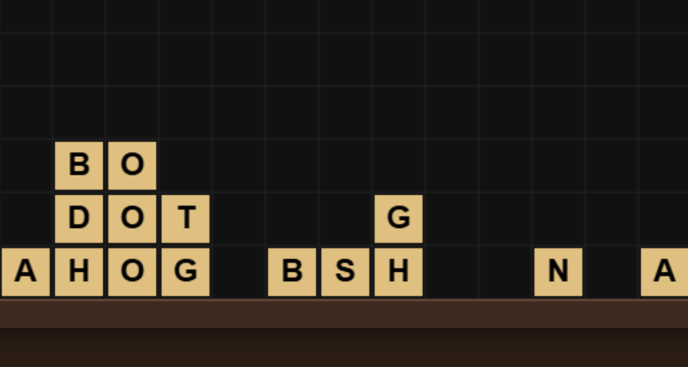

# Word Blocks Widget (ЛР5)

Интерактивный веб-виджет для игры «Словесный Тетрис» на HTML5 Canvas. 
Ядро логики импортируется из проекта ЛР4 (ES6-модули).

## 📌 Структура проекта
- `index.html` — разметка страницы (Canvas, HUD).
- `css/style.css` — тёмная коричневая тема оформления.
- `js/widget.js` — игровой цикл, отрисовка, ввод.
- `js_core/` — математическое ядро из ЛР4 (game.js, block.js, rect.js, constants.js).
- `Screen5_1.png`, `Screen5_2.png`, `Screen5_3.png` — скриншоты работающего виджета.

## 🎮 Управление
- **Стрелки ← →** — движение падающего кубика.
- **Стрелка ↓** — ускорить падение.
- **Клик мышью** по упавшему кубику — выделить букву.
- **Enter** — собрать слово.
- Если слово верное — кубики растворяются, счёт растёт.

## 🚀 Как запустить
Так как проект использует ES6-модули, запускать нужно через локальный сервер (не через `file://`).

1. Откройте терминал в папке проекта.
2. Запустите сервер (Python):
   ```bash
   python -m http.server 8000
   ```



