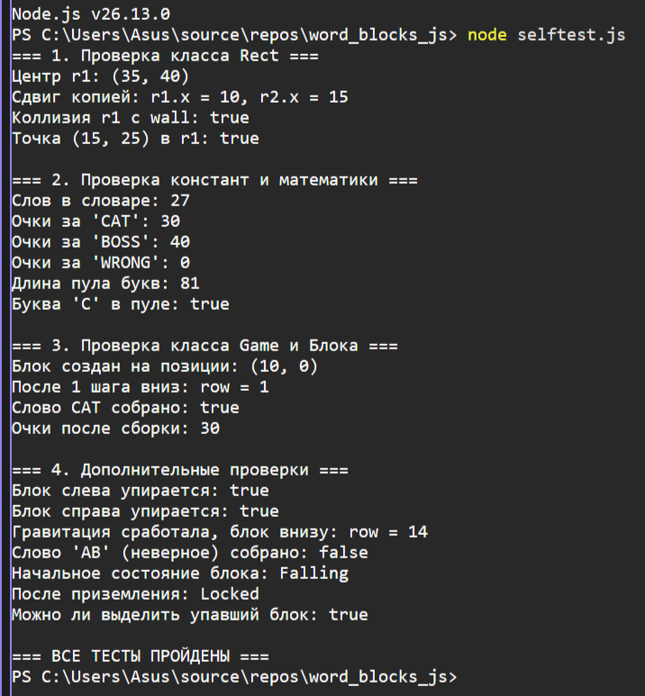

# Word Blocks JS (ЛР4)

Портирование математического ядра игры «Словесный Тетрис» с Python/Pygame на JavaScript (ES6+). 
Игра работает в среде Node.js без графического интерфейса. Проверка механик осуществляется через консольную самопроверку.

## 📌 Структура проекта
- `js/constants.js` — настройки игры, словарь и формула расчёта очков.
- `js/rect.js` — собственный класс прямоугольника (аналог `pygame.Rect`).
- `js/block.js` — класс падающего блока с конечным автоматом (FSM).
- `js/game.js` — игровое поле, логика падения, гравитация и сбор слов.
- `selftest.js` — файл самопроверки (20+ тестов).
- `package.json` — настройки проекта Node.js.

## 🧮 Расчёты и формулы
1. **Очки за слово:** `длина_слова * 10`. Реализовано в функции `calculateScore(word)`.
2. **Генерация букв:** пул букв собирается из разрешённых слов (`getLettersPool`), чтобы выпадали только те буквы, из которых можно составить слово.

## 🧠 Конечный автомат (FSM)
Блок проходит 4 состояния:
- `FALLING` — блок падает вниз.
- `LOCKED` — блок упал и зафиксирован.
- `SELECTED` — блок выделен игроком для сбора слова.
- `CLEARED` — блок удалён после успешного сбора.

## 🚀 Как запустить
1. Установите Node.js 18+.
2. Откройте терминал в папке проекта.
3. Запустите самопроверку командой `node selftest.js`.

## 📸 Результат работы
Ниже приведён скриншот успешного прохождения всех тестов:

